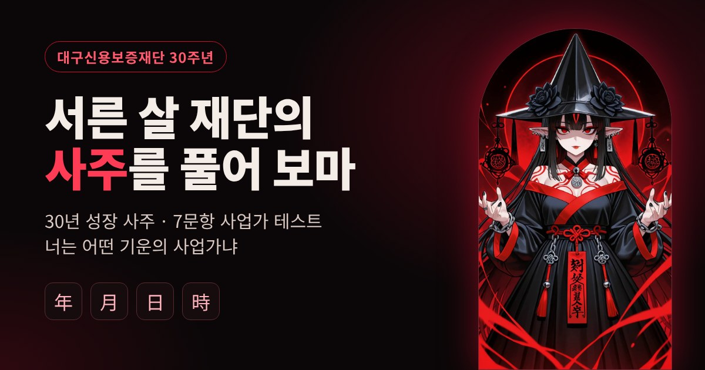
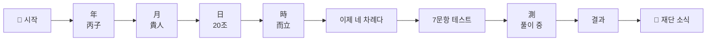
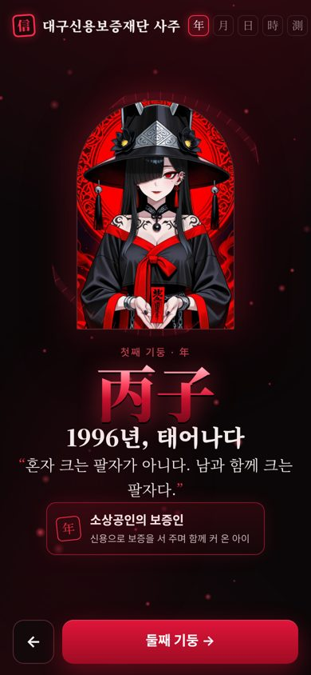
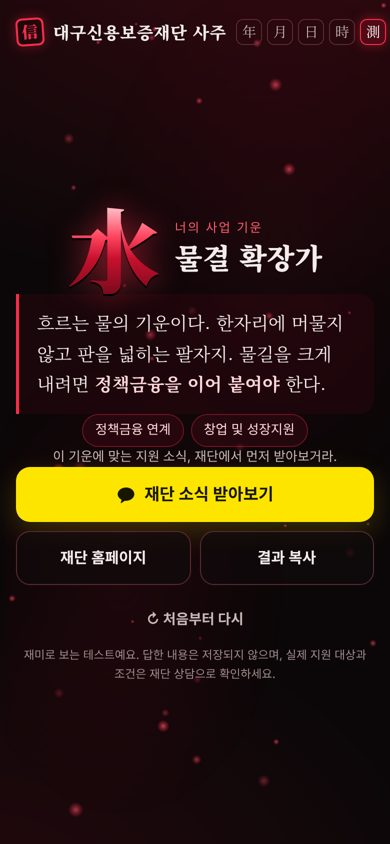

<div align="center">



# 🔮 대구신용보증재단 사주

### 1996년생 재단의 30년을 **사주**로 풀어낸 SNS 홍보 콘텐츠


<br/><br/>


### [🔗 바로 보기](https://moomooti.github.io/daegu-saju/)

</div>

<br/>

## 💡 기획 의도

> *"대구신용보증재단, 30년 동안 얼마나 성장했을까?"*

딱딱한 기관 실적을 그대로 나열하면 SNS에서는 아무도 끝까지 읽지 않아요.
그래서 **1996년에 설립된 재단을 "올해 서른 살이 된 아이"로 보고**, 사주를 봐주는 캐릭터 **'흑화 아기씨'**가 재단의 30년을 풀어 주는 콘셉트로 만들었어요.

읽고 끝나는 콘텐츠가 아니라 **직접 해보는 사업가 테스트**로 이어지게 해서, 자연스럽게 나에게 맞는 재단 지원 사업까지 알아보게 했어요.

<br/>

## 🎬 흐름: 한 화면에 한 장면

스크롤 없이 **버튼을 누를 때마다 다음 장면으로** 넘어가요. 장면마다 흑화 아기씨의 한마디와 핵심 하나만 보여줘요.



<table>
<tr>
<td width="60%" valign="top">

| 기둥 | 한마디 | 부적 |
|:-:|---|---|
| **年** 丙子 | 혼자 크는 팔자가 아니다. 남과 함께 크는 팔자다. | 소상공인의 보증인 |
| **月** 貴人 | 세상이 흔들릴 때마다 남의 버팀목이 되었구나. | 2020 코로나19 금융안전망 |
| **日** 20조 | 말보다 숫자가 정직하지. | 경영실적평가 2년 연속 1위 |
| **時** 而立 | 새 집으로 옮기면 운의 그릇이 커진다. | 보증 → 종합금융 허브 |

</td>
<td width="40%" align="center">

</td>
</tr>
</table>

<br/>

## 🔥 사업가 테스트 · 7문항

<table>
<tr>
<td width="55%" valign="top">

질문이 한 화면에 하나씩 나오고, **답을 누르면 바로 다음 질문**으로 넘어가요. 일곱 개를 다 고르면 오행(火·水·土·木·金) 중 나의 사업 기운이 나와요.

- 🔥 **결과 타입**: 오행별 사업가 유형과 흑화 아기씨의 짧은 풀이
- 🏦 **어울리는 지원 키워드**: 유형별로 두 가지
- 📢 **재단 소식으로 연결**: 대구신용보증재단 **카카오톡 채널**과 홈페이지로 바로 이동
- 📋 **결과 복사**: SNS에 바로 공유
- 🔒 **답변은 저장하지 않아요.** 모든 계산이 브라우저 안에서만 이뤄져요.

</td>
<td width="45%" align="center">

</td>
</tr>
</table>

<br/>

## ✨ 특징

- **스크롤 없는 장면 전환**: 모든 장면이 휴대폰 한 화면에 들어가요 (360×640 작은 화면까지 확인)
- **파일 하나로 끝**: `index.html` 하나에 화면 · 스타일 · 동작 · 그림이 모두 들어 있어서, 설치나 빌드 없이 열면 바로 실행돼요.
- **모바일 우선**: SNS로 들어오는 사람이 대부분이라 휴대폰 화면에 맞춰 설계했어요.
- **공유 미리보기**: 카카오톡 · 인스타그램 등에 링크를 붙이면 미리보기 카드가 떠요.
- **사주 콘셉트 디자인**: 검정 · 진홍색 테마, 명조 · 바탕 계열 글꼴, 年 · 月 · 日 · 時 네비게이션

<br/>

## 📁 구조

```
daegu-saju/
├── index.html              # 페이지 전체 (HTML · CSS · JS · 캐릭터 그림 포함)
└── assets/
    ├── og-image.jpg        # 링크 공유 미리보기 이미지 (1200×630)
    ├── preview-pillar.jpg  # README용 기둥 장면
    └── preview-result.jpg  # README용 테스트 결과 화면
```

<br/>

## 🚀 배포 (GitHub Pages)

1. 레포 **Settings → Pages**
2. Source를 **Deploy from a branch**, 브랜치를 **main / (root)** 로 선택 → Save
3. 1~2분 뒤 `https://moomooti.github.io/daegu-saju/` 에서 열려요.

<br/>

## ⚠️ 안내

- 사주는 재단 설립 연도(1996년)를 바탕으로 한 **콘셉트이며 실제 명리 해석이 아니에요.**
- 페이지의 수치는 대구신용보증재단의 실적을 바탕으로 했고, 실제 지원 대상과 조건은 재단 상담으로 확인해야 해요.
